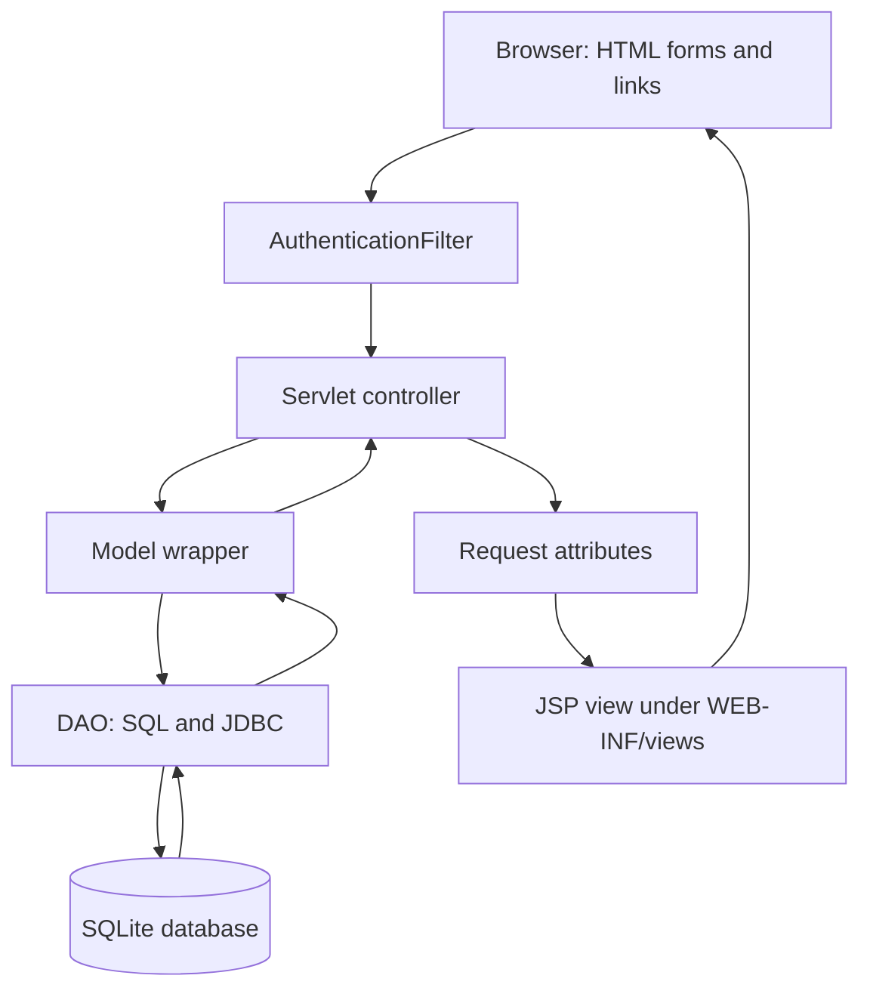
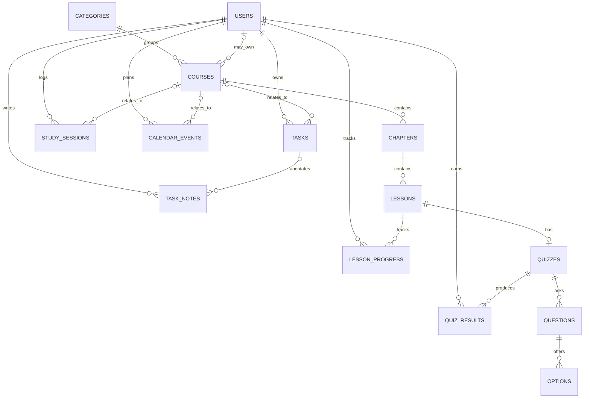

# StudyFlow: A Guided Tour of the Codebase

StudyFlow is a small study-planning web application. It lets a student browse a course catalog, take lesson quizzes, track tasks and notes, plan study blocks, record study time, and review activity on a dashboard and analytics page.

This guide is written for someone who understands basic programming and wants to learn how a real Java web application connects its pages, controllers, database, and browser code. It describes the code that is currently in this repository. It is intentionally detailed: use the links and request flows as a map while reading the source.

> **Important:** This is an educational project. Some choices are suitable for learning and a local class project, but the deployment/security notes near the end matter before exposing it to the public internet.

## Contents

- [1. Technology and project layout](#1-technology-and-project-layout)
- [2. Run it in Eclipse](#2-run-it-in-eclipse)
- [3. Understand the architecture](#3-understand-the-architecture)
- [4. URL and page map](#4-url-and-page-map)
- [5. Follow a request from browser to SQLite](#5-follow-a-request-from-browser-to-sqlite)
- [6. Features, step by step](#6-features-step-by-step)
- [7. Database tables and relationships](#7-database-tables-and-relationships)
- [8. Function and class reference](#8-function-and-class-reference)
- [9. JSP, JavaScript, and CSS](#9-jsp-javascript-and-css)
- [10. Security and correctness](#10-security-and-correctness)
- [11. Code-review notes and next improvements](#11-code-review-notes-and-next-improvements)
- [12. A learning path](#12-a-learning-path)
- [13. Troubleshooting](#13-troubleshooting)

## 1. Technology and project layout

| Part | Used here | What it does |
|---|---|---|
| Java | Java 21 | Implements HTTP request handling, validation, application rules, database access, and data objects. |
| Servlet API | Java EE Servlet 4.0 / Tomcat 9 (`javax.servlet` imports) | Connects HTTP URLs to Java controller classes and provides request/session objects. |
| JSP | JavaServer Pages with JSP scriptlets | Produces HTML on the server using data put on the request by controllers. |
| SQLite | SQLite file database | Stores users, catalog content, tasks, quizzes, study sessions, and planning data. |
| JDBC | SQLite JDBC driver 3.36.0.3 | Sends SQL statements from Java to SQLite and reads result rows. |
| Browser | HTML, CSS, JavaScript | Displays pages, handles small interactions, and renders analytics charts. |
| Bootstrap | Bootstrap 6 alpha CDN URL | Provides some responsive layout and interface styles. The project currently references an alpha release. |
| Chart.js | Chart.js 4.6.2 CDN on analytics page | Draws the study-time and activity charts. |

The project is an Eclipse Dynamic Web Project, not a Maven or Gradle project. There is no `pom.xml`. Eclipse compiles `src/main/java` to `build/classes`; `/build/` is ignored by Git.

```text
teamwork04/
├── src/main/java/aiwa/
│   ├── controller/   HTTP endpoints, login filter, shared controller helpers
│   ├── dao/          JDBC and SQL, database startup and migrations
│   ├── entity/       Java objects representing rows and view data
│   ├── model/        Small application-facing wrappers around DAOs
│   ├── service/      Cross-page application rules (activity and streaks)
│   ├── tools/        Small developer utility, not part of normal web requests
│   └── ulti/         HTML/CSRF/password helpers and a legacy greeting helper
├── src/main/webapp/
│   ├── WEB-INF/schema.sql   Initial table and index definitions
│   ├── WEB-INF/views/       JSP pages and shared JSP fragments
│   ├── WEB-INF/lib/         SQLite JDBC driver
│   ├── assets/css/          Shared styles
│   ├── assets/js/           Browser-side JavaScript
│   └── assets/images/       Logo and images
├── build/                   Eclipse compiler output (ignored by Git)
└── tool/, tools/            Additional project folders; not configured as Java source roots
```

Files inside `WEB-INF` cannot be requested directly by a browser. A URL such as `/WEB-INF/views/dashboard.jsp` should fail. The browser requests `/DashboardController`; that servlet prepares data and internally forwards the request to the JSP.

## 2. Run it in Eclipse

### Requirements

- Java Development Kit 21.
- Eclipse IDE with Enterprise Java/Web tooling.
- Apache Tomcat 9 configured in Eclipse.
- The SQLite JDBC JAR already present in `src/main/webapp/WEB-INF/lib`.

The `.classpath` file names JavaSE-21 and an Eclipse Tomcat 9 runtime. If Eclipse reports missing server/runtime entries, configure a matching JDK and Tomcat installation under **Preferences → Server → Runtime Environments**, then associate Tomcat with this project.

### Start locally

1. Import the project into Eclipse as an **Existing Projects into Workspace** project.
2. Confirm the project has Java 21 and Dynamic Web Module 4.0 facets.
3. Add the project to a Tomcat 9 server in the Servers view.
4. Start Tomcat and open the application's context path, commonly `http://localhost:8080/teamwork04/`.
5. Register a username and password, then sign in. Email is optional.

The context path depends on Eclipse/Tomcat deployment configuration. If it is not `teamwork04`, use the path shown in the server console or project deployment settings.

### Choose the SQLite file location

At startup `StudyFlowContextListener.contextInitialized` calls `Database.initialize`. The database file is selected in this order:

1. Java system property `studyflow.db`.
2. Environment variable `STUDYFLOW_DB`.
3. The deployed application's real path for `/WEB-INF/studyflow.db`.

The third choice is convenient for local development, but deployed application folders can be read-only or replaced during redeployment. For a persistent local database, configure a writable file path outside the deployed web application. The file path must point to the database you intend the app to use. DB Browser and the running web app can accidentally open different copies if their paths differ.

## 3. Understand the architecture

The project uses a simple MVC-like separation. It is not a strict textbook MVC framework, but the roles are clear enough to study:



### The main pieces

- **Browser:** Sends a `GET` when a user opens a link and a `POST` when a user submits a form. It also runs local JavaScript after the HTML arrives.
- **`AuthenticationFilter`:** Runs before servlet endpoints. It lets public pages through and redirects anonymous users away from private pages.
- **Controller servlet:** Reads request parameters, gets the logged-in user's numeric ID from the session, validates input, calls a model, then chooses a JSP or redirect.
- **Model:** A small Java facade. For example, `QuizModel.submit(...)` passes the operation to `QuizDAO`. The model keeps controllers from having SQL details.
- **DAO (Data Access Object):** Owns SQL. It uses JDBC prepared statements, converts `ResultSet` rows into entity objects, and writes changes.
- **Entity:** A JavaBean-style object carrying values, such as `Task`, `StudySession`, or `QuizAttempt`.
- **JSP:** Produces the page HTML. The controller places objects in `request` attributes before forwarding.
- **`ActivityService`:** Encapsulates activity events, chart series, and streak rules used by multiple screens.

### A small example of the separation

If the browser requests `/TaskController`, the filter checks the session. `TaskController.doGet` obtains `userId`, reads filters, and calls `TaskModel.getTasks`. The model calls `TaskDAO.findAll`. The DAO runs SQL with `user_id = ?`, turns each row into a `Task`, and returns a list. The controller stores that list as a request attribute and forwards to `tasks.jsp`. The JSP displays the list; it does not need to know how SQLite works.

## 4. URL and page map

The paths below are servlet mappings, not JSP filenames. Prefix them with the deployed context path, for example `/teamwork04`.

| URL | Controller | GET behavior | POST behavior | Main view |
|---|---|---|---|---|
| `/` and `/StudyController` | `StudyController` | Shows public landing page; authenticated visitors are sent to dashboard | — | `index.jsp` |
| `/home` | `StudyController` | Same landing-page route | — | `index.jsp` |
| `/LoginController` | `LoginController` | Displays sign-in form | Checks username/password and creates a session | `login.jsp` |
| `/RegisterController` | `RegisterController` | Displays account form | Validates fields, hashes password, inserts user, signs them in | `register.jsp` on error; otherwise redirect |
| `/LogoutController` | `LogoutController` | Not used for logout | Checks CSRF token, invalidates session, redirects | — |
| `/DashboardController` | `DashboardController` | Loads overview data | — | `dashboard.jsp` |
| `/CoursesController` | `CoursesController` | Shows categories, category courses, or selected course lessons | Updates or deletes an editable course | `coursesjsp.jsp` |
| `/QuizController` | `QuizController` | Shows a course's quizzes, a quiz, or an attempt result depending on query parameters | Scores and saves an attempt | `quiz-list.jsp`, `quiz-take.jsp`, or `quiz-result.jsp` |
| `/QuizHistoryController` | `QuizHistoryController` | Shows attempts for a course | — | `quiz-history.jsp` |
| `/TaskController` | `TaskController` | Lists/filters tasks and notes | Creates, edits, completes, or deletes a task | `tasks.jsp` |
| `/TaskNoteController` | `TaskNoteController` | Not used; notes are on the task page | Creates, edits, or deletes a note | Redirects to tasks |
| `/PlannerController` | `PlannerController` | Shows a week of planned items; completed items are optional | Creates, removes, or completes planner items | `planner.jsp` |
| `/ActivityController` | `ActivityController` | Loads analytics and current timer | Starts/stops timer or saves a manual study session | `analytics.jsp` |

Query parameters select a view or filter. Examples:

```text
/CoursesController?categoryId=2
/CoursesController?courseId=7
/QuizController?courseId=7
/QuizController?quizId=4&courseId=7
/QuizController?resultId=12
/QuizHistoryController?courseId=7
/PlannerController?week=2026-11-23&showCompleted=1
/TaskController?status=in_progress
```

## 5. Follow a request from browser to SQLite

### GET: read and display

1. The browser requests a URL such as `/CoursesController?courseId=7`.
2. Tomcat matches `/CoursesController` to `CoursesController` using `@WebServlet`.
3. `AuthenticationFilter` runs first. If no valid session exists, the user is redirected to login.
4. The controller reads `userId` from the session through `ControllerSupport.userId`.
5. The controller calls a model method, such as `CourseModel.getLessons(7, userId)`.
6. The model delegates to the relevant DAO.
7. The DAO gets a JDBC `Connection`, binds values to a `PreparedStatement`, executes SQL, and maps each `ResultSet` row into an entity.
8. The controller calls `request.setAttribute("lessons", lessons)`.
9. `RequestDispatcher.forward` invokes a JSP under `WEB-INF/views` in the same request.
10. The JSP writes HTML. Tomcat sends that HTML to the browser.

### POST: validate, save, redirect

Most write forms follow **POST → Redirect → GET (PRG)**:

1. A JSP form sends `POST` to its controller and includes a hidden CSRF token.
2. The controller checks the token before writing anything.
3. It parses and validates input. Browser validation is useful for usability, but server-side validation is the real boundary.
4. The controller/model/DAO inserts or updates rows. Ownership is part of the SQL predicate so one user cannot modify another user's row by changing an ID in the form.
5. A short flash message is stored in the session.
6. The controller responds with `sendRedirect` to a GET route.
7. The next GET reads and displays the changed data, then consumes the flash message.

PRG prevents refreshing a result page from submitting the same form a second time. It also gives the browser a clean URL after a write.

### JDBC pattern

A DAO typically uses this shape:

```java
try (Connection connection = Database.getConnection();
     PreparedStatement statement = connection.prepareStatement(sql)) {
    statement.setLong(1, userId);
    try (ResultSet rows = statement.executeQuery()) {
        // Read columns from each row and create Java objects.
    }
}
```

`try-with-resources` closes the result set, statement, and connection even if an exception occurs. `?` placeholders keep user-provided values out of SQL syntax, preventing SQL injection for those values. SQL table and column names cannot be parameterized, so dynamic SQL fragments must come from trusted code.

## 6. Features, step by step

### Account registration and login

Registration accepts a unique username, optional email, and password plus confirmation. `RegisterController` checks username length (2–60), validates the email only when present, checks matching passwords and a password length of 10–128, hashes the password with `PasswordHasher`, and calls `UserDAO.create`. The user is then signed in through `ControllerSupport.establishUser`.

Login accepts username and password. `UserDAO.findActiveByUsername` returns an active account and its password hash. `PasswordHasher.verify` derives a candidate hash and compares it to the stored hash. A correct password establishes a session. The email is not used as the login identifier.

### Course browsing and lessons

`CoursesController.doGet` loads the available courses, categories, and quizzes. With no selection it renders the category cards. A category selection filters courses. A course selection loads lessons and shows that course's lesson content and quiz links. Opening a course records one `course_opened` activity event for the current day/type.

The catalog can contain shared courses (`courses.user_id IS NULL`) and user-owned courses (`courses.user_id` is the current user). Course editing/deletion is restricted to courses owned by that user; shared catalog records are read-only through this controller. The code has update/delete handling, not a general public “add course” operation.

### Quiz taking and course progress

Quizzes belong to lessons. The path is course → chapters → lessons → quiz → questions → options. `QuizController` ensures the quiz is available through the user's accessible course before showing or accepting it.

When the student submits answers:

1. The browser sends selected option IDs under parameter names such as `q_23` (question ID 23).
2. The controller parses IDs and checks the quiz/course association.
3. `QuizDAO.submit` loads the actual correct options from the database and calculates the score on the server. The submitted page cannot claim that an answer was correct just by changing a browser value.
4. The score and total number of questions are inserted into `quiz_results` for the signed-in user.
5. The controller records a `quiz_completed` activity and redirects to the result URL.

Course progress is calculated in `Study.getProgressPercent()` from course task and quiz aggregates loaded by `CourseDAO.findAll`:

```text
totalUnits     = number of course tasks + total number of quiz questions
completedUnits = completed tasks + best correct-answer count across the course's quizzes
progress       = round(completedUnits / totalUnits * 100)
```

The quiz component uses the best score for each quiz, not the sum of every repeated attempt, and caps correct answers at the course's total question count. If there are no tasks and no questions, progress is 0% (there is no denominator). Dashboard “in progress” courses are only shown after the course has been started (a completed/in-progress task or at least one quiz attempt) and while progress is below 100%.

### Task notes

`TaskController` lists tasks and the task-note list, and handles task create/update/complete/delete actions. `TaskNoteController` owns note writes. Notes can optionally be attached to a task; when linked, the controller verifies the task belongs to the same user before saving. A note is still retained if its task is removed because the foreign key uses `ON DELETE SET NULL`.

### Planner

The planner combines user-created calendar events with tasks and, when requested, completed study sessions. `PlannerController.weekStart` normalizes any valid selected day to Monday, then `doGet` creates seven day buckets for Monday–Sunday and places each returned item into its date bucket.

- A **study plan** needs a start and end time between 15 minutes and 12 hours.
- An **exam** needs a start time; its end time can be empty.
- New events must be scheduled in the future.
- Study blocks cannot overlap another planned or logged study session for that user.
- Completed planner items and completed tasks are hidden by default. `showCompleted=1` asks the DAO to include completed items.
- The POST actions are `create`, `delete`, and `setCompleted`.

### Study timer and analytics

`ActivityController.doGet` loads recent sessions, totals, daily chart series, streak, courses, and any active timer. Starting the timer creates a `study_sessions` row with a start timestamp and a null `ended_at`. A partial unique index guarantees there can be only one active timer row per user. Stopping updates that active row with an end timestamp.

The server refuses to save a manual study session while the timer is active. Manual sessions must be 1–720 minutes, cannot start in the future, and accept at most 500 characters of notes. The browser's `analytics.js` calculates the visible ticking clock from the saved start timestamp; the database timestamps remain authoritative for actual session duration.

The streak counts distinct study dates found from completed study sessions **or** activity events. A streak can continue through today or, before the user has acted today, through yesterday. Opening a course, finishing a quiz, completing/saving a task, or saving a note counts as activity. The service writes no more than one event of a given type per user per local date, so refreshing the page does not inflate that event count.

## 7. Database tables and relationships

The initial table definitions are in `src/main/webapp/WEB-INF/schema.sql`. The runtime startup code also performs small migrations so an existing local database can be upgraded.



`||` means exactly one parent, `o{` means zero or many children, and `o|` means an optional relationship. For example, a course may have no owner because it is a shared catalog course. A task may have no course.

| Table | Purpose and notable rules |
|---|---|
| `users` | Account ID, unique username, optional unique case-insensitive email, password hash, created time, active flag (0/1). |
| `categories` | Course grouping; category name is unique. |
| `courses` | Catalog content and optional owner; every course has a category. Null `user_id` represents shared catalog content. |
| `chapters` | Ordered sections of a course. |
| `lessons` | Ordered lesson content, with optional example code. |
| `quizzes` | One quiz per lesson (`lesson_id` is unique). |
| `questions` | Quiz question text and optional explanation. |
| `options` | Choices for questions; `is_correct` must be 0 or 1. |
| `lesson_progress` | Per-user completion state, unique per user and lesson. |
| `quiz_results` | Per-user quiz attempts, with score ≥ 0, total > 0, and score ≤ total. |
| `tasks` | Per-user task, optional course, due time, priority and status constrained to known values. |
| `study_sessions` | Study interval; a null end time means the timer is active. End must follow start. |
| `study_activity_events` | Dated action used in analytics and streak calculation; event type is constrained. |
| `calendar_events` | User-owned study block or exam; study events need an end time. |
| `task_notes` | User-owned note, optionally linked to a task; title and body have database length checks. |

### Keys, deletion behavior, and indexes

- Each table has an integer primary key. SQLite assigns increasing IDs with `AUTOINCREMENT`.
- Foreign keys describe valid parent/child connections. `Database.openConnection` enables SQLite foreign-key checking for each new connection.
- Deleting a user cascades to that user's tasks, sessions, results, progress, activities, plans, and notes.
- Deleting a course sets linked task/session/calendar course references to null so the user's records are not erased.
- Deleting a task leaves its note but removes the task link.
- Deleting lessons and their dependent learning content can cascade where the schema specifies it.
- Indexes speed up user/date filtering, task status/due-date views, calendar date lookups, and course uniqueness/order checks. `idx_one_active_study_session_per_user` is a **partial unique index**: it only indexes rows with `ended_at IS NULL`.

### Database startup and migrations

`StudyFlowContextListener.contextInitialized` calls `Database.initialize`. Initialization selects the database file, executes the schema SQL, then runs compatibility migrations. The current migrations:

1. Rebuild the `users` table when required so email can be optional while preserving existing user data and IDs.
2. Add `calendar_events.is_completed` to an older schema if it is absent.
3. Create a disabled legacy user and attach old unowned lesson progress/quiz results to that account so the new owner columns can be non-null.
4. Add `courses.user_id` to an older schema if needed.
5. Ensure current indexes exist and create a `General` category if the category table is empty.

Migrations check the existing schema before changing it so normal restarts do not repeatedly apply the same column addition. Before changing a database schema for real users, make a separate backup file and test the migration on a copy.

## 8. Function and class reference

This section focuses on methods that control behavior. Entity classes also expose ordinary getters and setters for their fields; these accessors simply read or assign values and are grouped below by entity. DAO mapping methods copy database columns into those fields.

### Controllers (`aiwa.controller`)

| Class / method | Responsibility |
|---|---|
| `AuthenticationFilter.init(config)` | Initializes the servlet filter; the current implementation has no custom configuration to load. |
| `AuthenticationFilter.destroy()` | Servlet lifecycle hook; currently has nothing to release. |
| `AuthenticationFilter.doFilter(request, response, chain)` | Reads the path and session; redirects a signed-in user away from home to dashboard; allows public routes; sends anonymous private-route visitors to login with an encoded `next`; otherwise calls the next filter/servlet. |
| `AuthenticationFilter.isPublic(path)` | Returns whether the request is for a public route, the login/register endpoints, static assets, or favicon. |
| `AuthenticationFilter.isHome(path)` | Detects root/index/home routes that should lead authenticated users to their dashboard. |
| `ControllerSupport.userId(request)` | Reads and validates the numeric user ID stored in the session. Controllers use this rather than trusting a user ID submitted by a form. |
| `ControllerSupport.positiveInt(value)` | Parses a positive integer request parameter, returning null for invalid/absent values. |
| `ControllerSupport.optionalPositiveInt(value)` | Treats a blank value as no selection, otherwise requires a positive integer. |
| `ControllerSupport.flash(request, type, message)` | Stores a one-time notification in session for the next redirected page. |
| `ControllerSupport.exposeFlash(request)` | Moves/reads a pending message for display by the current request and removes it so it does not repeat. |
| `ControllerSupport.establishUser(request, user)` | Rotates the session ID, sets a 30-minute inactivity timeout, creates a fresh CSRF token, and saves the signed-in user's ID and name in session. |
| `StudyController.doGet(...)` | Forwards to the public landing page. The filter redirects already signed-in users to the dashboard first. |
| `LoginController.doGet(...)` | Shows login form and preserves an allowed `next` path. |
| `LoginController.doPost(...)` | Validates CSRF, looks up an active username, verifies the PBKDF2 password, establishes the session, and redirects to a safe destination. |
| `LoginController.safeNext(next)` | Rejects external, protocol-relative, backslash, CR/LF, and otherwise unsafe redirects; only accepts a local application path. |
| `RegisterController.doGet(...)` | Shows account creation form. |
| `RegisterController.doPost(...)` | Checks CSRF, username, optional email, matching password and password length; hashes the password; inserts a user; starts a session. |
| `RegisterController.showError(...)` | Repopulates non-secret form fields and forwards the validation message; password fields should not be echoed. |
| `LogoutController.doPost(...)` | Requires a valid CSRF token, invalidates the user's session, and redirects to public home/login. Logout is POST-only. |
| `DashboardController.doGet(...)` | Loads courses, active progress courses, task counts, upcoming tasks, current planner week, study streak, weekly minutes, and activity calendar. |
| `CoursesController.doGet(...)` | Loads category and course data, chooses category/course/lesson view mode, groups available quizzes by course, records course-open activity, and forwards to the course JSP. |
| `CoursesController.doPost(...)` | Validates CSRF and supports update/delete for an owned editable course. It does not create arbitrary catalog courses. |
| `CoursesController.readCourse(...)` | Validates course name, category, description length, and level, then constructs a `Study` object from submitted fields. |
| `QuizController.doGet(...)` | Selects the course quiz list, take-quiz screen, or result screen based on `courseId`, `quizId`, or `resultId`; checks user/course access before forwarding. |
| `QuizController.doPost(...)` | Validates CSRF and quiz/course IDs, reads `q_<questionId>` option choices, calls server-side scoring, records activity, and redirects to the result. |
| `QuizHistoryController.doGet(...)` | Validates the selected course and loads only the current user's attempt history for it. |
| `TaskController.doGet(...)` | Loads filtered tasks, courses, notes, and note data for the task page. |
| `TaskController.doPost(...)` | Validates CSRF and handles task create/update/toggle/delete actions; records task activity as appropriate; then redirects to task GET. |
| `TaskController.readTask(...)` | Builds a task from request values after checking title, description, allowed priority/status, due date, and course access. |
| `TaskController.allowed(value, choices...)` | Checks a submitted enum-like value against the allowed list instead of accepting arbitrary status/priority text. |
| `TaskNoteController.doPost(...)` | Validates CSRF, dispatches note create/update/delete actions, and redirects back to tasks. |
| `TaskNoteController.readNote(...)` | Validates note title/body and, if supplied, confirms the linked task belongs to the signed-in user. |
| `PlannerController.doGet(...)` | Normalizes a requested date to the week's Monday, creates seven day buckets, loads planner records, and optionally includes completed records. |
| `PlannerController.doPost(...)` | Validates CSRF and handles create/delete/complete actions. For new events it validates course ownership and checks study-time overlap. |
| `PlannerController.readEvent(...)` | Validates event type/title/start/end and the allowed study-block duration, returning a `PlannerItem`. |
| `PlannerController.parseDateTime(value, message)` | Parses a local date/time field; converts parse failures to a clear validation message. |
| `PlannerController.weekStart(value)` | Parses a requested date (or falls back to today) and returns the previous-or-same Monday. |
| `ActivityController.doGet(...)` | Loads analytics totals, streak, session history, action counts, chart series, courses, and any active session. |
| `ActivityController.doPost(...)` | Validates CSRF; starts/stops the timer or validates and saves a manual study interval; disallows manual save while a timer runs. |

Servlet `doGet`/`doPost` methods are lifecycle entry points called by Tomcat. They are not invoked directly by JSP pages; the browser's HTTP method causes Tomcat to invoke the appropriate method.

### Models (`aiwa.model`)

Models here are intentionally thin. They create a DAO and expose application-named methods. If business rules grow, the model/service layer is where multi-DAO workflows can be centralized.

| Model | Method | Meaning |
|---|---|---|
| `CourseModel` | `getCourses(userId)` | Reads shared and user-owned courses with task/quiz progress aggregates. |
| | `getCategories()` | Reads categories. |
| | `getLessons(courseId, userId)` | Reads lessons only if the course is accessible to this user. |
| | `update(course, userId)`, `delete(courseId, userId)` | Modifies only user-owned editable courses. |
| | `isAvailableToUser(courseId, userId)` | Checks whether it is shared or owned by the user. |
| `TaskModel` | `getTasks(userId, status, priority, courseId, limit)` | Reads user's tasks with optional filters and maximum result count. |
| | `create(task)`, `update(task)` | Inserts or changes a task. Ownership rules are enforced by DAO SQL. |
| | `complete(taskId, userId, completed)` | Sets completion status and completion timestamp consistently. |
| | `delete(taskId, userId)` | Deletes only a task belonging to that user. |
| | `count(userId, status)` | Counts all tasks or tasks in one state. |
| `TaskNoteModel` | `getNotes(userId)`, `ownsTask(taskId, userId)` | Reads notes and checks task ownership. |
| | `create(note)`, `update(note)`, `delete(noteId, userId)` | Writes or removes a user-owned note. |
| `StudyModel` | `createSession(session)` | Saves a completed/manual study interval. |
| | `getActiveSession(userId)`, `startSession(userId, courseId)`, `stopSession(userId)` | Reads, creates, and ends the user's timer record. |
| | `getRecentSessions(userId, limit)`, `getTotalMinutes(userId)` | Reads history and sums completed session minutes. |
| `PlannerModel` | `getWeek(userId, weekStart)` | Reads a planner week with completed items hidden. |
| | `getWeek(userId, weekStart, includeCompleted)` | Variant that can show completed tasks/plans and logged sessions. |
| | `hasStudyOverlap(userId, start, end)` | Checks overlapping study blocks for that user. |
| | `create(item, userId, courseId)`, `deleteEvent(id, userId)`, `setCompleted(id, userId, completed)` | Adds, removes, or completes a user-owned planner event. |
| `QuizModel` | `getAvailable(userId)`, `getAvailableForCourse(userId, courseId)` | Lists available quizzes for all accessible courses or a single course. |
| | `getQuiz(quizId, userId)`, `getQuestions(quizId)` | Reads an accessible quiz and its questions/options. |
| | `submit(userId, quizId, answers)` | Delegates server-side scoring and result persistence. |
| | `getHistory(userId)`, `getHistoryForCourse(userId, courseId)`, `getAttempt(userId, resultId)` | Reads only that user's quiz attempts. |

### DAOs (`aiwa.dao`)

| DAO | Main functions and what they teach |
|---|---|
| `Database` | `initialize(context)` selects file, executes schema, and runs migrations; `getConnection()` opens a configured connection; `openConnection()` applies SQLite pragmas; `executeSchema(...)` reads and executes SQL; `migrateOptionalUserEmail`, `migrateCalendarEventCompletion`, `migrateCourseOwnership`, `migrateOwnership`, `ensureLegacyUser`, and `createIndexes` upgrade old database versions; `hasColumn` inspects table metadata. This class centralizes connection and schema setup. |
| `UserDAO` | `findActiveByUsername(username)` queries an active account for login; `create(user)` inserts account data and returns its generated key. |
| `CourseDAO` | `findAll(userId)` reads courses and computes task/quiz aggregates; `findCategories()` reads category values; `findLessons(courseId,userId)` returns ordered course lessons and quiz counts; `update`/`delete` mutate only owned courses; `isAvailableToUser` checks shared-or-owned access. |
| `TaskDAO` | `findAll(...)` builds parameterized filters; `create`/`update` persist fields; `setCompleted` updates status and `completed_at`; `delete` and `count` are user-scoped; `map(ResultSet)` maps a row to a `Task`; `format`/`parse` convert date-time values; `setNullableInt` binds a nullable foreign key correctly. |
| `TaskNoteDAO` | `findAll(userId)` joins task titles for display; `ownsTask` verifies a task; `create`/`update`/`delete` are user-scoped; `parse` maps stored timestamps; `setNullableInt` handles an optional task relationship. |
| `StudysessionDAO` | `findActive` gets the unended timer; `start` inserts a running session; `stopActive` ends the user's active session; `create` inserts a completed session; `findRecent` lists history; `totalMinutes` sums ended intervals; `format`/`parse` convert timestamps; `setNullableInt` binds optional course IDs. |
| `PlannerDAO` | `findWeek` combines calendar events, tasks, and optionally completed study sessions into `PlannerItem`s; `hasStudyOverlap` searches overlapping intervals; `create` inserts a calendar event; `deleteEvent` and `setCompleted` are user-scoped; `format`/`parse` convert local date-times. |
| `QuizDAO` | `findAvailable` and `findAvailableForCourse` list quizzes joined through lessons/chapters/courses; `findQuiz` checks a quiz's course access; `findQuestions` builds question objects and adds their option objects; `submit` independently finds correct options, calculates score, and inserts result; `findHistory` and `findHistoryForCourse` read owned attempts; `findAttempt` reads one owned result; `isAvailable` checks access; `historySql` supplies shared history query structure; `mapQuiz`/`mapAttempt` convert rows into entities. |

### Service (`aiwa.service`)

| Method | Responsibility |
|---|---|
| `ActivityService.recordAction(userId, eventType)` | Allows only known event names and records no more than one of a given type per user/date. |
| `getDailyActions(userId, days)` | Returns a date-to-count map of qualifying action events for the most recent number of days. |
| `getDailyMinutes(userId, days)` | Returns a date-to-study-minutes map for completed sessions. |
| `getWeeklyMinutes(userId)` | Builds seven minute totals in Monday-to-Sunday order. |
| `getWeekdayLabels()` | Returns the matching localized weekday labels for the chart. |
| `getStudyStreak(userId)` | Unions days with a completed study session or action, then counts consecutive dates ending today or yesterday. |
| `getActivityLevel(minutes)` | Converts minute totals to a small intensity bucket for the activity heatmap. |

### Utilities (`aiwa.ulti`)

| Method | Responsibility |
|---|---|
| `Html.escape(value)` | Encodes HTML-sensitive characters before dynamic text is written into HTML. Use it for user-controlled and database text. |
| `Html.dateTime(value)` | Formats a Java `LocalDateTime` for readable display. |
| `Html.csrfToken(request)` | Gets or creates a cryptographically random session token for form submissions. |
| `Html.validCsrfToken(request)` | Compares submitted and session CSRF values using a constant-time comparison. |
| `PasswordHasher.hash(password)` | Creates a random salt and PBKDF2-HMAC-SHA256 password hash with the project's iteration count; returns a versioned string containing algorithm, iterations, salt, and derived bytes. |
| `PasswordHasher.verify(password, encoded)` | Parses and bounds-checks the stored format, re-derives the hash, and uses constant-time byte comparison. |
| `PasswordHasher.derive(password, salt, iterations)` | Uses Java `SecretKeyFactory` and `PBEKeySpec` to derive the fixed-size key. |
| `Ulti.showGreeting()` | Legacy greeting helper; it is not part of the core request/data flow. |

### Entity classes and their accessor groups (`aiwa.entity`)

Entity getters and setters follow JavaBean naming: `getName()` reads a property; `setName(value)` assigns it; booleans commonly use `isActive()`. JSP expression/scriptlet code can call getters to render data. These methods do not query the database.

| Entity | Stored/display fields and notable computed method |
|---|---|
| `User` | `userId`, `username`, `email`, `passwordHash`, `active`; account identity and login record. |
| `Study` | Course identity, owner/category/name/description/level and task/quiz progress aggregates; `getProgressPercent()` calculates course completion. |
| `Category` | Category ID and name. |
| `Lesson` | Lesson ID, chapter/title/order, lesson content/example, quiz ID and question count. |
| `Quiz` | Quiz/course/category/lesson IDs or names, title, question count. |
| `QuizQuestion` | Question ID/text/explanation and an initialized list of `QuizOption`; options are added after questions are loaded. |
| `QuizOption` | Option ID/text and correctness flag. Correctness is used server-side for scoring; user-facing question rendering should not expose it. |
| `QuizAttempt` | Result/quiz/course IDs, names, lesson, score, question total and completion timestamp; `getPercent()` calculates attempt percentage. |
| `Task` | Task/user/course IDs, joined course name, title, description, due date, priority/status, created and completed times. |
| `TaskNote` | Note/user/optional task IDs, joined task title, title/body and update time. |
| `StudySession` | Session/user/optional course IDs, course name, start/end, notes; `getDurationMinutes()` computes elapsed whole minutes for a completed interval. |
| `PlannerItem` | Unified planner item ID/type/title/course/time/status/priority/completion; `isUserEvent()` distinguishes persisted calendar events from task/session rows. |

## 9. JSP, JavaScript, and CSS

### JSP views

Views live in `src/main/webapp/WEB-INF/views`. Each page is supplied with request attributes by a controller. The `components` directory contains shared page fragments such as the document head, navigation header, footer, and planner tabs. JSP scriptlets (`<% ... %>`) execute Java while rendering HTML. Dynamic values should be escaped using `Html.escape(...)` before interpolation.

| View | Purpose |
|---|---|
| `index.jsp` | Public landing page. |
| `login.jsp`, `register.jsp` | Public account forms. |
| `dashboard.jsp` | Signed-in overview. |
| `coursesjsp.jsp` | Categories, courses, lessons, and course quiz links. |
| `quiz-list.jsp`, `quiz-take.jsp`, `quiz-result.jsp`, `quiz-history.jsp` | Quiz selection, question form, attempt result, and per-course attempt history. |
| `tasks.jsp` | Task list/actions and notes. |
| `planner.jsp` | Week view with planned and optionally completed items. |
| `analytics.jsp` | Study sessions, timer, streak, activity grid, and Chart.js containers. |

### JavaScript files

- `assets/js/analytics.js` updates the visible elapsed timer once per second, parses JSON data embedded by the JSP, and creates weekly and monthly Chart.js charts. If Chart.js is unavailable, it displays a readable fallback message. It does not calculate the authoritative study duration or save records; the controller and database do that.
- `assets/js/tasks.js`, `dashboard.js`, `api.js`, and `app.js` are present in the project. At the time this guide was written, these files are placeholders/comments rather than active application logic. Most feature behavior is server-rendered by JSP and controllers.
- Some small interactions are inline in JSP pages rather than in the external scripts.

### CSS and libraries

`assets/css/style.css` is the shared visual stylesheet. The head fragment loads it on pages, along with Bootstrap CSS/JS from a CDN. Analytics also loads Chart.js. When debugging a missing style or chart, check browser developer tools for failed CSS/JavaScript network requests and inspect the generated HTML for the correct context path.

## 10. Security and correctness

Good practices already present in this code:

- Passwords are stored as salted PBKDF2-derived hashes, not plaintext.
- Login requires an active user and uses a username, not a client-submitted user ID.
- The filter protects private routes; controllers use the session's user ID.
- Mutating forms use CSRF tokens, and logout is a POST operation.
- DAOs use prepared statements for data values.
- Queries that mutate or read user-specific records include owner IDs.
- Quiz correctness is computed from the database on the server.
- Dynamic HTML should be escaped with `Html.escape`.
- SQLite foreign-key enforcement is enabled on connections; schema checks constrain status values and invalid score/time ranges.
- A partial unique index limits each user to one active timer.
- Login redirects are checked to avoid open redirects.

Things to understand before deploying beyond a local learning environment:

1. **SQLite file placement and backups:** Keep the live DB in a persistent writable location and back it up. Do not assume a database under a deployed WAR folder survives replacement.
2. **Transport security:** Public deployment needs HTTPS. Session cookies should be configured as Secure, HttpOnly, and SameSite through the servlet container/application configuration.
3. **JSP escaping:** Every dynamic value inserted into HTML must be encoded for its output context. HTML escaping does not by itself make values safe in JavaScript, CSS, or URLs.
4. **Database busy/write behavior:** SQLite is useful for one small instance and light concurrent writes. If multiple server instances or significant concurrent writes are expected, use a server database such as PostgreSQL and introduce a connection pool/migrations framework.
5. **CSRF response behavior:** Keep CSRF checks on every state-changing route and avoid GET endpoints that mutate data.
6. **Account policy:** Password validation and recovery/rate limiting should be designed before real users depend on accounts. Never log plaintext passwords or password hashes.
7. **Driver and CDN maintenance:** Check and update old dependencies deliberately. The Bootstrap link currently targets an alpha version; pin a supported stable version and its correct integrity hash when upgrading.
8. **Migration rollback:** Back up before migrations. For more complex changes, wrap all related DDL/data changes in a transaction where SQLite supports it and test on a copy.

## 11. Code-review notes and next improvements

These notes are observations about the current implementation, not changes made by this README:

- `components/plantabs.jspf` currently contains a full `DOCTYPE`, `html`, `head`, and `body` document even though it is included as a fragment in other pages. That can produce invalid nested HTML. A JSP fragment should contain only the tab navigation markup (plus any needed local declarations that safely fit the inclusion pattern).
- Many controllers repeat input parsing, error handling, flash messages, and redirects. As the app grows, extract shared validation/service logic while keeping the first version easy to follow.
- `Database` owns schema execution and several migrations. A next step could be explicit numbered migration files so every schema version has a reviewable history.
- JSP scriptlets mix presentation and Java logic. A later refactor could use JSTL/EL or a template system, but first learn the current request-attribute flow and escape every value.
- Several entity classes are mutable JavaBeans with many accessors. This is fine for a servlet/JSP class project; immutable records/value objects could be introduced later where compatible with the view layer.
- The external JavaScript placeholders add little value until they contain code. Either move actual page behaviors into them or remove unused script includes after confirming they are not referenced.
- The project has developer utility copies under `tool/` and `tools/`, but Eclipse's `.classpath` compiles only `src/main/java`. Treat the latter as the application's compiled source root and avoid keeping divergent duplicate utilities.
- A small service layer currently exists only for activity logic; multi-step quiz/task/planner business rules can gradually move from controllers into focused services.
- The UI uses JSP scriptlets and SQLite directly through DAOs. That is a reasonable learning scope; avoid introducing frameworks until you can explain the data path in this README.

## 12. A learning path

Try this sequence while keeping the running app open:

1. **Find the page route:** Start at `@WebServlet` on a controller and match it to the URL table above.
2. **Read one GET path:** Follow `TaskController.doGet` → `TaskModel.getTasks` → `TaskDAO.findAll` → `tasks.jsp`.
3. **Read one POST path:** Follow a task form → `TaskController.doPost` → validation → DAO write → redirect → GET. Identify where the CSRF token is created and checked.
4. **Trace one SQL result:** In `TaskDAO.map`, match each `ResultSet.get...` call to a `Task` property and then the JSP getter that displays it.
5. **Trace quiz scoring:** Follow `QuizController.doPost` → `QuizModel.submit` → `QuizDAO.submit`. Confirm the server reads `is_correct` from SQLite rather than trusting browser data.
6. **Trace a database constraint:** Find the `tasks.status` CHECK in `schema.sql`, then find controller validation, then find the status displayed in the JSP.
7. **Read the timer:** Follow `analytics.jsp` fields → `ActivityController.doPost` → `StudyModel` → `StudysessionDAO` → `study_sessions`; then see how `analytics.js` displays elapsed time.
8. **Change a safe display detail:** Adjust a label or CSS rule, reload, and inspect the rendered HTML. Keep logic changes separate from styling changes.
9. **Add a small feature:** Write down its table/entity, validation rule, controller route, DAO query, view, and ownership rule before coding.

For each method, ask: What data comes in? What does it validate? Which layer owns the rule? What can it change? Who owns the affected row? What does it return or render? What happens when the database fails?

## 13. Troubleshooting

### I get a 404

- Use the servlet URL (for example `/DashboardController`), not a JSP inside `/WEB-INF/views`.
- Check the deployment context path; it might not be `/teamwork04`.
- Confirm the servlet class is under `src/main/java` and Tomcat finished deploying without an error.
- The filter redirects anonymous users; a login redirect may be mistaken for a missing page.

### A newly registered user is missing in DB Browser

- Compare the exact file path DB Browser has open with the path chosen by `Database.initialize`.
- Check whether `studyflow.db` is under the deployed application's `WEB-INF` folder or an explicitly configured external location.
- Refresh DB Browser after the application commits its insert. Registration uses `UserDAO.create` and SQLite JDBC.
- Do not use `CheckUsers.java` on a real database unless you have reviewed its connection settings and output; it is a developer utility, not the web account-management screen.

### The courses page has no quiz

- A quiz requires a lesson, at least one question, and answer options in the database.
- Confirm course → chapter → lesson → quiz links are present.
- The quiz list is queried for courses available to the signed-in user (shared or user-owned).
- For a course progress percentage, quiz attempts need to be submitted; course progress uses best correct answers, not just opening a quiz.

### Course progress is not visible on the dashboard

- A course appears in the dashboard's in-progress list only after it has a completed/in-progress task or at least one quiz attempt.
- A course at 100% is considered complete and is omitted from that active list.
- Progress uses task count and quiz-question count as its denominator. Courses with no tasks or quiz questions remain at 0%.

### Study time or streak looks wrong

- Active timer rows have `ended_at IS NULL`; only ended sessions add minutes to analytics.
- Stop the timer to save the interval. A manual session cannot be added while a timer is running.
- Streak uses local dates from completed sessions and qualifying activity events. It can span a missed “today” only if yesterday had activity.
- Check that both the browser app and DB Browser are looking at the same database file.

### The chart does not appear

- Check that Chart.js loaded from its CDN and the page includes the correct `analytics.js` URL.
- The page expects JSON in `#analytics-chart-data` and canvas IDs `weeklyStudyChart` and `monthlyStudyChart`.
- If the CDN is blocked, the JavaScript shows a fallback message; the stored analytics data is still on the server.

### SQLite reports a constraint or locked database error

- A CHECK error means the submitted status, score, or time range violates the schema rule; follow validation and DAO values together.
- A foreign-key error often means the referenced course/user/quiz does not exist or the selected record belongs to another user.
- A busy/locked error can happen when DB Browser and the web app both hold a write lock or when concurrent writes occur. Close unused DB Browser edit transactions and refresh; for persistent multi-user concurrency, consider a server database.

